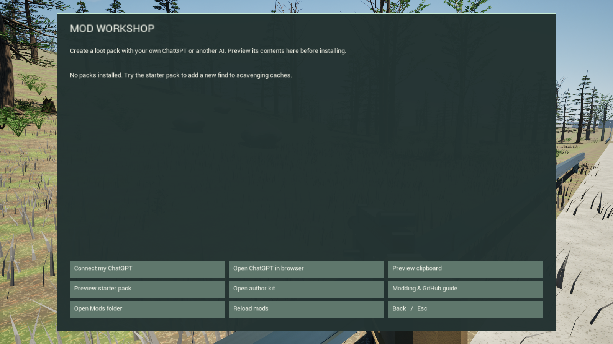

# EARTHtotaled

In 1986, fraudCORP space traveler Mara Venn enters a time warp. She crash-lands at SHELTER 09 in 2253 and follows the last signal through endless forests and ruined cities. Water keeps you alive. Candybar wrappers are the currency.

## Play on Windows

Run **EARTHtotaled-Setup.exe**, choose a version, and select **Install and play**. Setup installs missing Microsoft prerequisites. Pin **EARTHtotaled** from the Windows Start menu to keep the same shortcut across versions. [Download the Windows installer](https://github.com/moswald14/earthtotaled/releases/latest/download/EARTHtotaled-Setup.exe)

Open **Game updates** from the title or pause menu to select a GitHub release. Confirm to save, install and relaunch, or keep playing. Setup preserves all ten slots and mods. Older versions use a separate copy of your progress. Return to the latest to resume your main survivor. You can also open **Manage EARTHtotaled versions** from Start. [All releases and portable ZIPs](https://github.com/moswald14/earthtotaled/releases)

**Ride the Ringline.** Open **M**, press **R** to frame the loop, and click a teal station to track it. Follow the line to the station about 95 m north of the Shelter 09 landing site. Take the stairs or press **E** under the platform for the lift. Press **E** on the platform to wait for the next train, then jump across the striped edge. The open flatbed reaches 396 km/h on its 22.5 km circuit through eight cities. It stops for 12 seconds at each station. You can walk around the deck, jump off, or save aboard and resume the ride.

The 4K surfaces cover forest ground, bark, concrete, asphalt, steel, Bug carapaces and Supertech hulls. Pause and select **Render detail** to cycle through 100%, 125%, 150%, 175% and 200%. At 200%, a 1920 × 1080 display renders the scene at 3840 × 2160.

Start a new survivor for the crash landing and the Drifter .44. Press **G** and fire at the four marked trench stakes to defend Shelter 09. Ground Bugs stop at the holes. Reclaimed cities stay settled. Hostile kills have a 1-in-400 chance to spill a gun with rolled stats, two perks and a damage-based upgrade path. Hold **Ctrl** near it to collect it and use **Tab → Unique gun rack** to inspect and equip it.

Daylight lasts 52 real minutes and night lasts 22. Shelter 09 is safe. Clear infected towns, then use their settlement boards to fund the watch, build walls and place powered sentries. Track the hill cistern for drinking water. Your shield recharges after combat. Medkits restore health. Approach spilled loot and hold **Ctrl** to sweep it into your pack.

H7 Blackpine Highway and H2 Relay Highway link towns, Bug hives and Supertech cities. Press **M** to plot a route. Mine wilderness ground for resources. Cities, roadbeds and built foundations are protected against excavation at every depth. Earn survivor XP through quests, encounters, harvesting and mining. Press **K** to inspect the 18-node skill web and spend a point when you level up.

## Mods and contributions

Choose **Mod workshop** from the title or pause menu to try the starter pack, connect your own ChatGPT, or install a pack made by another player or AI. Create custom loot and decide where it drops and what it buys. Larger additions can be submitted to the game's main branch. [Modding how-to](work/earthtotaled-unreal/Content/ModWorkshop/README.md) · [Contributing to the game](CONTRIBUTING.md)

Mine iron and gold, build a relay, and defend your turtle miners with auto turrets. Valuable bases draw Bug raids. Repel one to trace its nest. Richer seams and armored creatures lie beneath the seeded hills and valleys. The fullscreen game includes ten survivor slots, portable save files, and an F1 field console.

- [Download the playable Windows release on itch.io](https://coralsorta.itch.io/earthtotaled)
- [Unreal source, build instructions, and controls](work/earthtotaled-unreal/README.md)
- [Release record and verification limits](docs/RELEASES.md)
- [Remaining full-release checks](docs/RELEASE-CHECKLIST.md)

## Source layout

`work/earthtotaled-unreal` is the active Unreal Engine 5.8 project. Its C++ source, design data, original art/audio source files, and generation/import tools are versioned. Unreal's generated assets, caches, compiled binaries, and packaged downloads are rebuilt locally.

`work/earthtotaled` preserves the older browser game and its WebView2 launcher source. Its `dist` directory contains the actual browser source modules, including the Three.js vendor file and license; it is intentionally tracked. The Unreal design-export tool reads this sibling project. Browser and Unreal saves are separate.

Run `npm test` from `work/earthtotaled` for the legacy source checks and standalone HTML build. Generated test copies stay local and are recreated by the test scripts.

Release scripts write disposable packages and reports into the repository's ignored `outputs` directory; the legacy browser build writes `work/earthtotaled/standalone/EARTHtotaled.html`. Player saves, local work logs, credentials, and editor caches are excluded. Keep the two project folders in this layout when running their existing scripts.

## Unreal build

Install Unreal Engine 5.8, compatible Visual Studio C++ build tools, the Windows SDK, .NET Framework 4.8 development components, Python 3.11 or newer, and Node.js. Epic's engine is installed separately; it is not redistributed here.

From `work/earthtotaled-unreal`, use the commands in its README. The checked-in `ArtSource` files and `Content/Data` can be imported directly with `./Build-Unreal.ps1 -Mode Content`; regenerating the source art and speech is optional. Then run `./Build-Unreal.ps1 -Mode Package`. Keep every file in the resulting Windows game folder together.

The game opens fullscreen. F11 changes between fullscreen and a window. Start it and right-click its taskbar icon to pin it. Escape opens the saved music/weather volume controls and pauses survival.

## Export the complete source

From the repository root, run `python work/earthtotaled-unreal/Tools/package-source.py`. It writes `outputs/EARTHtotaled-complete-source.zip` with both project folders, shared documentation, and original art/audio source. The older source ZIP files are left intact.

The exporter requires a Git checkout and packages tracked files with their current edits. Review and stage intended new files first. It refuses unmerged changes, unreviewed new files, and tracked player data or local work logs. `SOURCE-MANIFEST.json` records each included file's SHA-256, the base commit, and whether the source has uncommitted changes. A Git checkout is needed only for this export command; extracting the ZIP preserves the layout needed by the game build and check scripts.

## Rights and dependencies

This repository does not grant an open-source license for EARTHtotaled's original code, story, art, or music. Retained third-party notices apply to their respective components. The older browser edition includes Three.js under its bundled MIT license. Its optional desktop launcher requires Microsoft's separately downloaded WebView2 SDK; that SDK and compiled game/engine files are not committed.
